# 🎼 Calculadora de Tonalidad Global
https://senyclever.github.io/calculadora-tonalidad-global/

> Analiza la tonalidad de tus beats, canciones y sesiones musicales trabajando con Sonic Visualiser.  
> Calcula la escala dominante, visualiza familias armónicas, detecta modulaciones y genera informes listos para compartir.

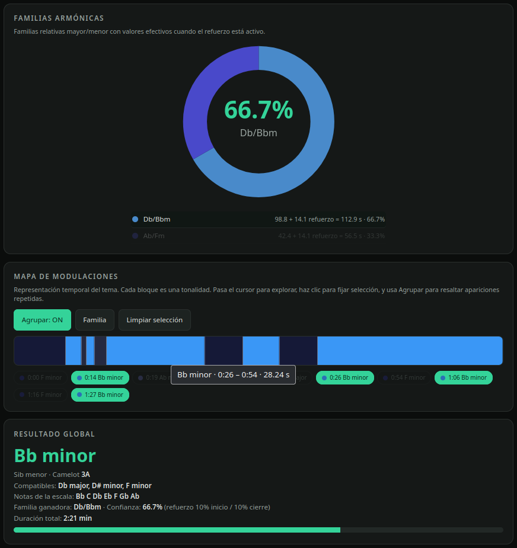

_Parte de la calculadora, con una sesión ya cargada, mostrando familias armónicas, mapa de modulaciones y resultado global de tonalidad._

---

## 🚀 ¿Qué hace esta calculadora?

La **Calculadora de Tonalidad Global** es una herramienta **offline**, sin dependencias y pensada para:

- 🎧 Productores musicales
- 🎹 Compositores
- 🎛️ DJs
- 🥁 Beatmakers
- 🎚️ Ingenieros creativos
- 📚 Estudiantes de teoría musical

Su objetivo es ayudarte a responder una pregunta muy común:

> ¿En qué tonalidad está realmente esta canción?

Pero no solo eso: también te muestra cómo esa tonalidad evoluciona en el tiempo.

---

## ✨ Características principales

- ✅ Funciona completamente **offline**.
- ✅ Un solo archivo HTML.
- ✅ Sin instalación.
- ✅ Sin dependencias externas.
- ✅ Compatible con Sonic Visualiser.
- ✅ Importación de archivos CSV.
- ✅ Soporte para pegar CSV directamente.
- ✅ Soporte para arrastrar y soltar archivos CSV.
- ✅ Análisis de tonalidades individuales.
- ✅ Análisis de familias armónicas relativas.
- ✅ Mapa visual de modulaciones.
- ✅ Refuerzo de inicio y cierre.
- ✅ Resultados con código Camelot.
- ✅ Notas de la escala ganadora.
- ✅ Leyenda de tiempos para capítulos de YouTube.
- ✅ Exportación de informe en TXT.
- ✅ Exportación/importación de historial en JSON.
- ✅ Interfaz oscura, clara y pensada para flujo de trabajo musical.

---

## 🖥️ Capturas de pantalla

### 📥 Importación desde Sonic Visualiser

Puedes pegar el contenido del CSV, importar el archivo o arrastrarlo directamente.

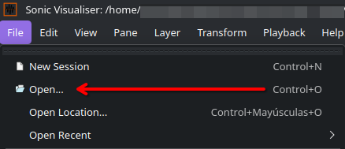

_Tarjeta “Importar CSV de Sonic Visualiser”._

### 📥 Análisis de tonalidad del Audio en Sonic Visualiser

Busca la opción: "Key Detector: Key...".

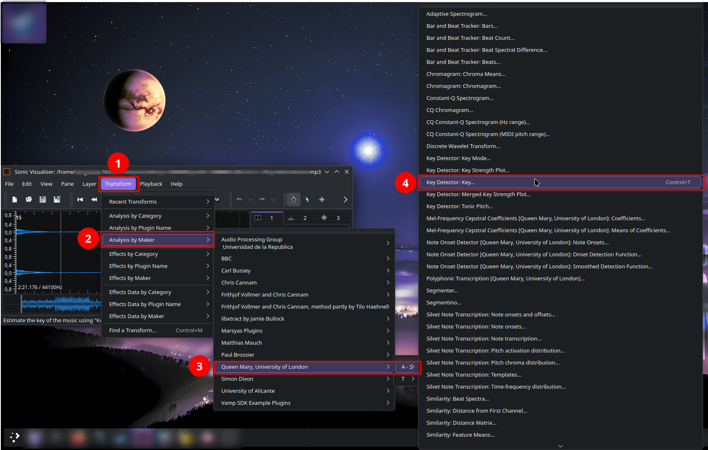

_Para una búsqueda mas exacta y universal: "Transform", "Analysis by Maker", "Queen Mary", "University of London" y "Key Detector: Key...". de Sonic Visualiser._

## 📥 Ejemplo de CSV compatible

El repositorio incluye un archivo de ejemplo real exportado desde Sonic Visualiser:

📄 [examples/ejemplo_sonic_visualiser.csv](examples/ejemplo_sonic_visualiser.csv)

Su contenido es:

```csv
0.000000000,18,F minor
14.860770975,23,Bb minor
19.319002268,9,Ab major
20.805079365,23,Bb minor
23.034195011,9,Ab major
26.749387755,23,Bb minor
54.984852608,18,F minor
66.130430839,23,Bb minor
76.532970522,18,F minor
87.678548753,23,Bb minor
```

La calculadora entiende tanto los códigos numéricos como las etiquetas de tonalidad:

- `1–12` = tonalidades mayores
- `13–24` = tonalidades menores

Puedes descargarlo y arrastrarlo directamente a la calculadora para probarla sin necesidad de analizar tu propio audio.

---

### ⏱️ Ventana de duración total del audio

Al importar un CSV, la calculadora solicita la duración exacta del audio para calcular correctamente el último segmento.

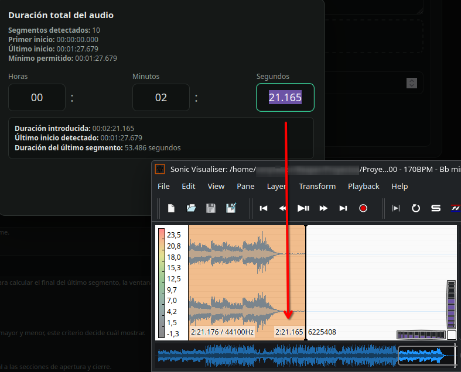

_Modal de duración total con horas, minutos y segundos. (Utiliza Sonic Visualiser arrastrando la linea vertical (Playhead) al final del audio)._

---

### 🎛️ Entrada de datos

Nombre de sesión, unidad, BPM, compás, carácter y refuerzo.

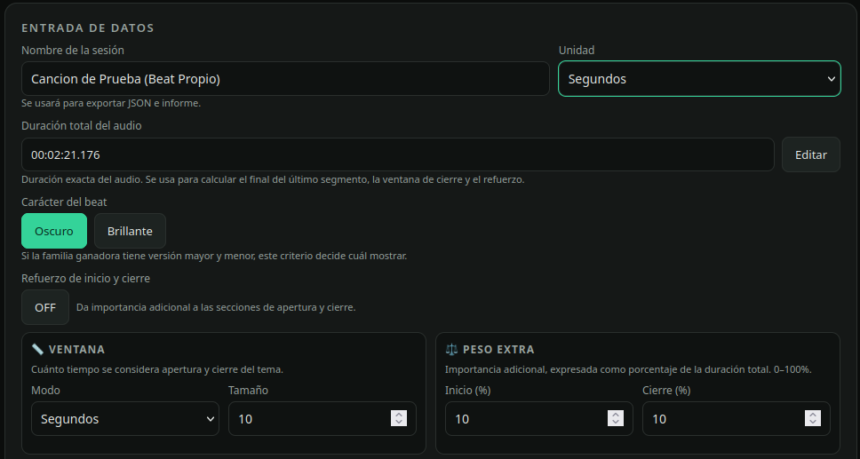

_Tarjeta “Entrada de datos” con una sesión cargada._

---

### 🍩 Distribución de escalas

Cada tonalidad aparece representada según su presencia temporal.

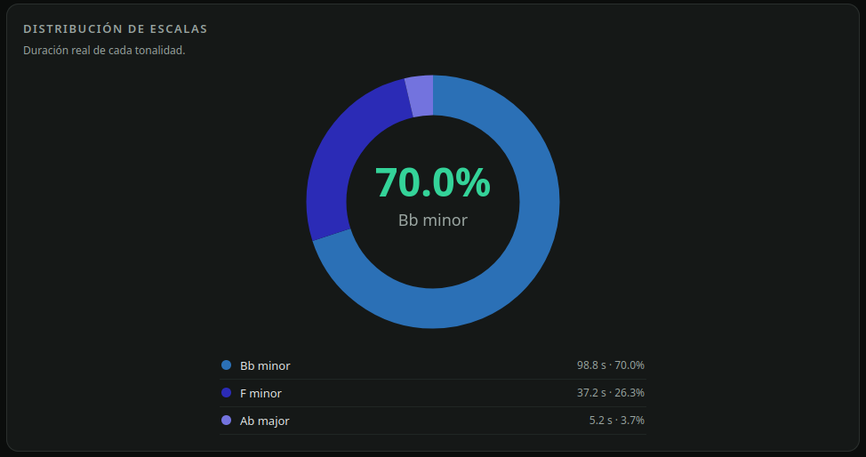

_Gráfico de dona y la leyenda de distribución de escalas._

---

### 🧬 Familias armónicas

Las familias agrupan tonalidades relativas que comparten las mismas notas.

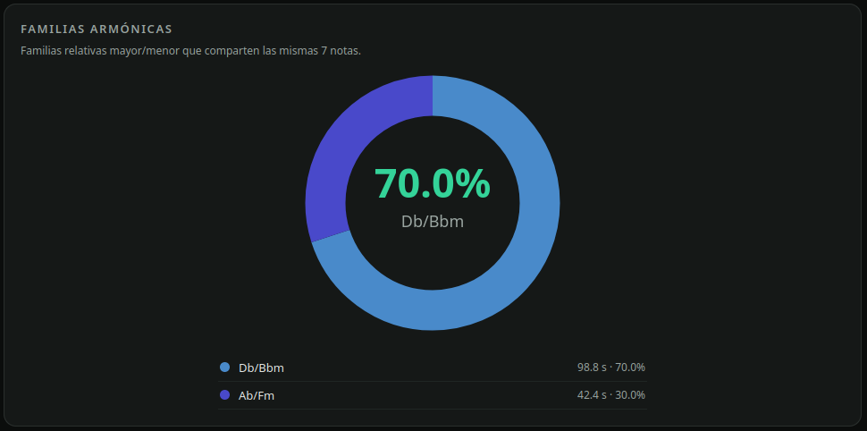

_Sección “Familias armónicas”._

---

### 🗺️ Mapa de modulaciones

Una barra temporal muestra los cambios de tonalidad a lo largo del tema.

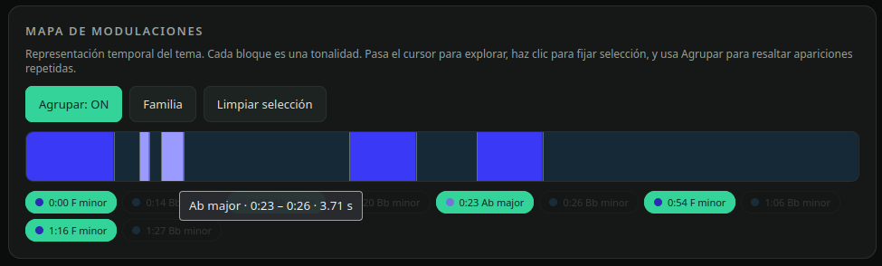

_Mapa de modulaciones con varios colores, agrupando las familias armónicas._

---

### 🏆 Resultado global

La calculadora entrega la tonalidad principal, su familia, compatibilidad Camelot y las notas de la escala.

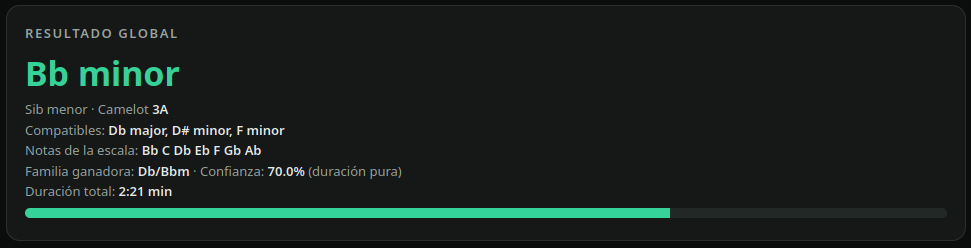

_Resultado global con una tonalidad ganadora._

---

### ⚖️ Refuerzo de inicio y cierre

El refuerzo permite dar más peso a las secciones de apertura y cierre del tema.

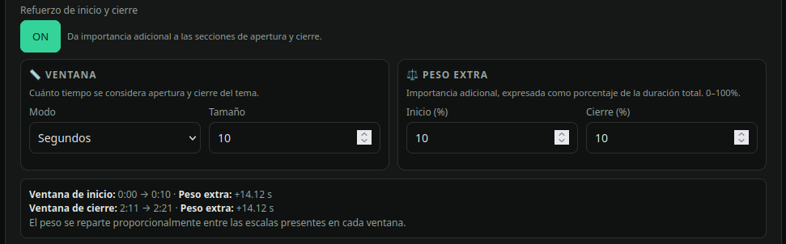

_Ejemplo del refuerzo activado, mostrando ventana y peso extra._

---

### 💾 Historial

Puedes guardar sesiones, exportarlas e importarlas.


_Tarjeta “Historial” con sesiones guardadas._

---

### 📄 Informe generado y Descargar ".txt" de la Guía de uso.

El informe incluye resultado global, distribución, segmentos, notas y leyenda de tiempos. También puedes descargar una guía mas detallada sobre el uso completo de la calculadora de tonalidad global.

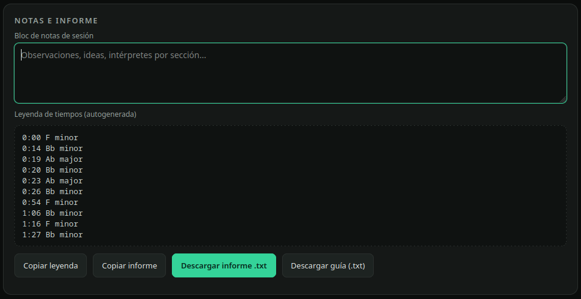

_Informe TXT abierto o copiado._

---

## 🧠 ¿Por qué esta herramienta?

Muchos detectores automáticos dan una sola tonalidad para toda la canción.

Pero la música real no siempre funciona así.

Una canción puede:

- empezar en una tonalidad,
- modular hacia otra,
- alternar entre relativo mayor y menor,
- tener secciones ambiguas,
- confirmar la tonalidad recién en el cierre.

Esta calculadora no te obliga a confiar en una sola respuesta automática.

Te permite trabajar con segmentos temporales y entender el comportamiento armónico del tema completo.

---

## 🎨 Usos Creativos

La calculadora no es solo una herramienta de análisis: también es un instrumento de composición. Estas son algunas formas de exprimirla dentro de tu flujo creativo.

### 🎧 Detecta la tonalidad REAL de tus samples

Muchos samples, loops y acapellas circulan transpuestos: el archivo que descargaste puede no estar en la tonalidad del original.

Analiza el sample con Sonic Visualiser, importa el CSV y obtén:

- la tonalidad real que SUENA en tu archivo,
- las notas exactas de esa escala,
- su código Camelot.

Así sabrás si debes transponerlo para que encaje con tu beat, o si está listo para soltarse directo en el arreglo.

### 🔀 Mashups y acapellas sin chocar

Con el código Camelot del resultado puedes combinar materiales de orígenes distintos:

- mismo número, letra opuesta (ej.: 10A con 10B),
- número vecino, misma letra (ej.: 10A con 9A u 11A).

Si la acapella está en 8A y tu instrumental en 8B, la mezcla nace armónicamente limpia.

### 🎹 Snap a escala en el DAW

Copia las 7 notas de la escala ganadora y actívalas en el "scale snap" o "resaltar escala" de tu DAW.

Resultado: cada melodía, lead o contramelodía que dibujes quedará dentro de la tonalidad del tema, sin notas fuera de lugar.

### 🥁 Afina el 808 sección por sección

Si tu beat modula, el mapa de modulaciones te dice exactamente en qué segundo cambia la tonalidad.

Ajusta la raíz del bajo o del 808 en cada sección usando la leyenda de tiempos: el grave siempre estará cantando en la escala correcta.

### 🌗 Contraste emocional con familias relativas

Una familia armónica comparte las mismas notas entre su versión mayor y su menor.

Eso te permite escribir un verso oscuro en la versión menor y abrir el coro en la relativa mayor (o al revés) sin cambiar una sola nota de tu paleta: solo cambia el centro emocional.

### 🚀 Modulación como plano de arreglo

El mapa de modulaciones también se usa al revés: como partitura de decisiones.

Planifica de antemano dónde quieres que el tema despegue: un cambio a la relativa mayor en el último coro, o una subida de tonalidad para el cierre. La calculadora te deja ver y pesar ese plan antes de grabar nada.

### 🗂️ Sample packs organizados por tonalidad

Analiza cada loop de tu librería una sola vez y guarda su Camelot en el nombre del archivo:

`Loop_F#m_11A_92bpm.wav`

Cuando produzcas, no adivines: filtra por Camelot compatible y arma el beat en minutos.

### 🎛️ Sets DJ y transiciones armónicas

Exporta el informe de cada track de tu set y ordénalos por Camelot.

Las transiciones entre bloques compatibles suenan naturales; los saltos de familia los reservas para el momento de ruptura que tú elijas.

### 🤝 Colaboración sin fricción

Envía el informe .txt a quien colabore contigo: intérprete, mezclador o productor adicional.

En un solo archivo recibe tonalidad global, notas de la escala, secciones con tiempos y tus notas de sesión. Cero idas y vueltas de "¿en qué clave está esto?". Si quieres agregar el BPM, mídelo por separado y anotalo en la sección de notas e informe de la calculadora.

### 🎬 Crea contenido con ella

Analiza canciones famosas, samples icónicos o tus propios beats y publica el resultado de tus obras.

El informe y el mapa de modulaciones son material visual perfecto para videos cortos, hilos o clases de teoría musical aplicada.

¿Se te ocurre otro uso creativo? Ábrelo como Issue o compártelo: esta sección crece con la comunidad.

---

## 📦 Instalación

No necesita instalación.

### Opción 1 — Uso local

1. Descarga el archivo `index.html`.
2. Ábrelo con tu navegador.
3. Listo.

Funciona en:

- Windows
- macOS
- Linux
- Android
- iOS

Mientras el navegador sea relativamente moderno, debería funcionar correctamente.

---

### Opción 2 — Usar online con GitHub Pages

Si este repositorio está publicado con GitHub Pages, puedes usarlo directamente desde el navegador.

Botón sugerido:

```text
Usar online
